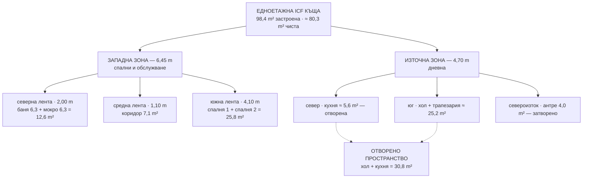
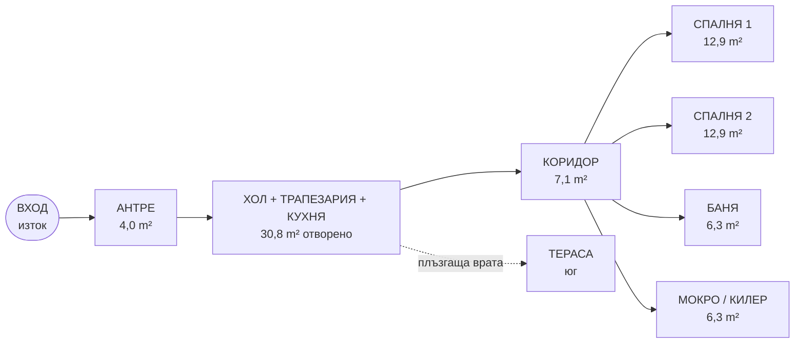
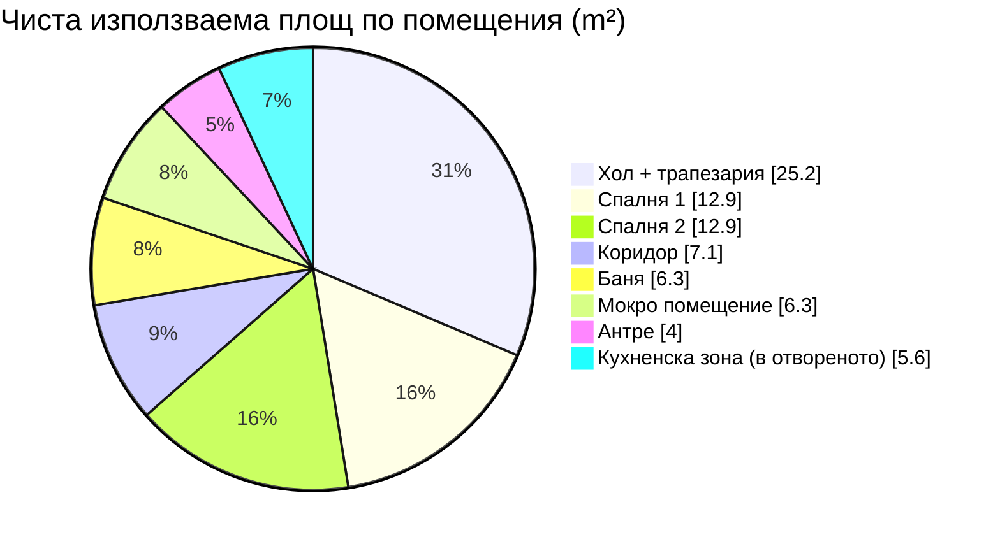
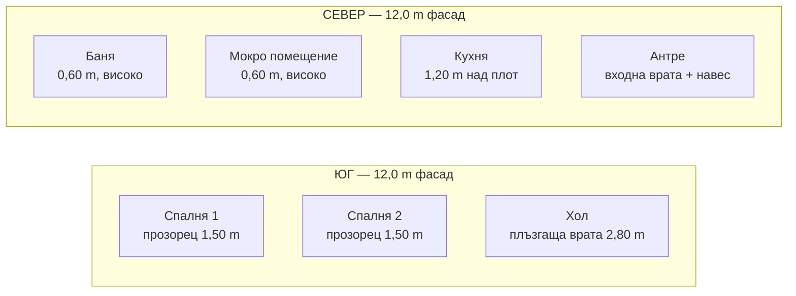
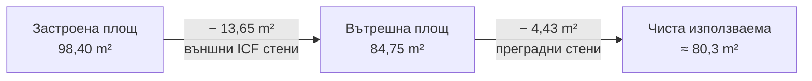
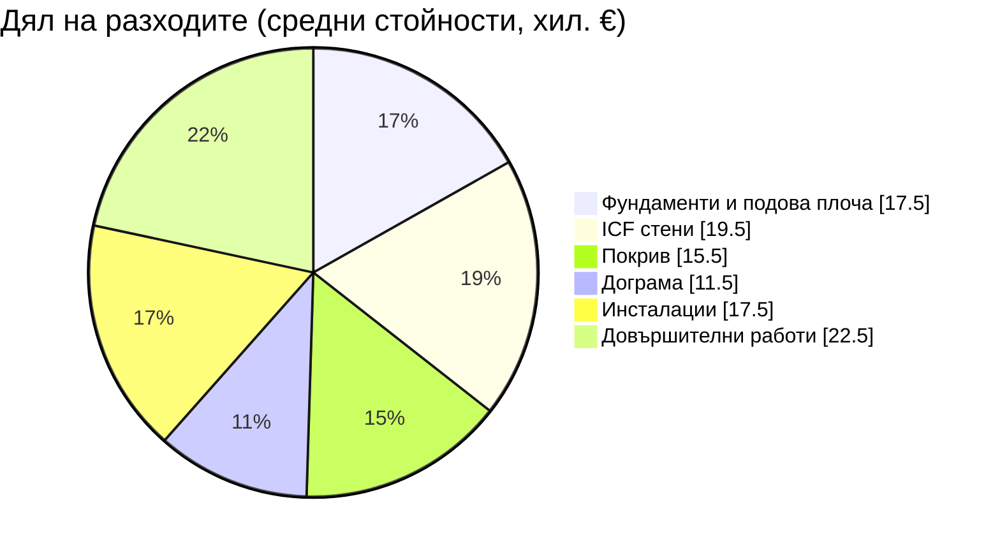

# Диаграми

Схематични диаграми към концепцията. Рендират се директно в GitHub и в VS Code
(Markdown Preview). Чертежите в мащаб са в [plans/](./plans).

---

## 1. Зониране

Геометричното разположение е в [плана 1:100](./plans/floor-plan.svg). Тази диаграма
показва йерархията зона → лента → помещения.

---

## 2. Циркулация

Най-дълъг маршрут: вход → антре → хол → коридор → спалня 1 ≈ **9 m**.

---

## 3. Разпределение на чистата площ

---

## 4. Ориентация по фасади

| Фасада | Отвори | Площ на стъклото | Стратегия |
|---|---|---|---|
| Юг | 3 броя | ≈ 10,5 m² | максимум светлина + задължително засенчване |
| Север | 3 малки + вход | ≈ 2,2 m² | минимум загуби, вентилация |
| Изток | вход + 1 прозорец | ≈ 2,2 m² | сутрешна светлина |
| Запад | 0–1 малък | 0–1,4 m² | защита от следобедно слънце |

---

## 5. Площна сметка (от застроена към чиста)

---

## 6. Ориентировъчно разпределение на разходите

Средни стойности от диапазона в [бюджета](../budget/01-cost-estimate.md) — **само за
илюстрация на пропорциите**, не са оферта.

Общо ≈ 104 000 € — в средата на диапазона 72 000 – 136 000 €.

---

## 7. Алтернативи, които бяха разгледани

| Вариант | Площ | Причина да не се избере |
|---|---|---|
| 12,00 × 8,00 m, вход от север | 96,0 m² | не отговаря на достъпа от изток |
| 12,00 × 8,00 m, вход от изток | 96,0 m² | отвореното пространство пада на ~27 m² (под 30) |
| 11,00 × 8,00 m | 88,0 m² | хол + кухня ~29 m² или спални под 11 m² |
| 12,30 × 8,00 m | 98,4 m² | равностойно; по-дълъг фасад, по-плитки стаи |
| **12,00 × 8,20 m** | **98,4 m²** | **избран** — по-добри пропорции на стаите |
| Спални, отворени към хола | ~93 m² | губи се приватност и звукоизолация |
